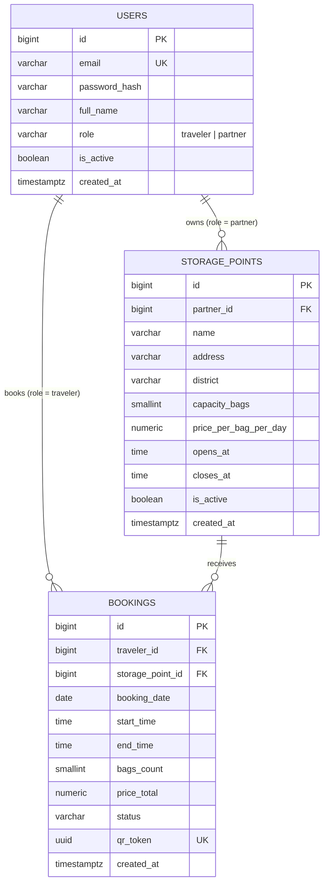

> Исторический черновик до интеграции. Актуальная схема: [db-schema.md](db-schema.md). Дневная цена и bookings ниже не отражают реализованный Sprint 1.

# StorageShare — Database Schema

Author: Dastan Opabek (Backend) · Date: 11 October 2026
Status: draft for the team review on 12 October 2026
Database: PostgreSQL · ORM: Django

This document describes the main data of StorageShare: the tables of the MVP, their
fields and how they are linked. It covers only the **Must** features from the
TSIS 1+2 Features List. Payments, ratings, reviews, notifications and the map are
out of scope, so they have no tables here.

## 1. Overview

Three tables:

| Table | What one row is |
| --- | --- |
| `users` | one person — either a traveller or a partner business |
| `storage_points` | one physical place where bags can be left |
| `bookings` | one traveller leaving N bags at one storage point for a time window |

Links:

- one partner (a user with `role = 'partner'`) has **many** storage points;
- one traveller (a user with `role = 'traveler'`) has **many** bookings;
- one storage point has **many** bookings.

## 2. ER diagram



## 3. Tables

### 3.1 `users`

Both sides of the marketplace live in one table: login, password and tokens work the
same way for a traveller and for a partner, and `role` is what separates them.

| Field | Type | Null | Notes |
| --- | --- | --- | --- |
| `id` | bigserial | no | primary key |
| `email` | varchar(254) | no | **unique**, used as the login |
| `password_hash` | varchar(128) | no | Django hash, never a plain password |
| `full_name` | varchar(120) | no | for a partner — the name of the business |
| `phone` | varchar(32) | yes | contact for the partner, optional for a traveller |
| `role` | varchar(16) | no | `traveler` or `partner` |
| `is_active` | boolean | no | default `true`; a blocked account is not deleted |
| `created_at` | timestamptz | no | registration time |

Constraints and indexes: unique index on `email`; `CHECK (role IN ('traveler','partner'))`;
index on `role`.

### 3.2 `storage_points`

| Field | Type | Null | Notes |
| --- | --- | --- | --- |
| `id` | bigserial | no | primary key |
| `partner_id` | bigint | no | **FK → `users.id`**, the owner; must have `role = 'partner'` |
| `name` | varchar(120) | no | e.g. "Almaty Hostel — reception" |
| `address` | varchar(255) | no | shown on the detail page |
| `district` | varchar(64) | no | the search filter of the MVP |
| `capacity_bags` | smallint | no | how many bags fit in total |
| `price_per_bag_per_day` | numeric(8,2) | no | in KZT |
| `opens_at` | time | no | the booking window must fit inside the opening hours |
| `closes_at` | time | no | |
| `description` | text | yes | free text from the partner |
| `security_notes` | text | yes | e.g. "locked room, camera" |
| `is_active` | boolean | no | default `true`; a partner hides a point instead of deleting it |
| `created_at` | timestamptz | no | |

Constraints and indexes: `FK partner_id → users(id)` with `ON DELETE RESTRICT`;
`CHECK (capacity_bags > 0)`; `CHECK (price_per_bag_per_day >= 0)`;
index on `(district, is_active)` — every search starts with these two columns.

### 3.3 `bookings`

| Field | Type | Null | Notes |
| --- | --- | --- | --- |
| `id` | bigserial | no | primary key |
| `traveler_id` | bigint | no | **FK → `users.id`**, must have `role = 'traveler'` |
| `storage_point_id` | bigint | no | **FK → `storage_points.id`** |
| `booking_date` | date | no | the day the bags are left |
| `start_time` | time | no | drop-off time |
| `end_time` | time | no | pick-up time |
| `bags_count` | smallint | no | |
| `price_total` | numeric(10,2) | no | `bags_count × price_per_bag_per_day × days` |
| `status` | varchar(16) | no | see the status flow below |
| `qr_token` | uuid | no | **unique**, the value encoded in the QR code |
| `checked_in_at` | timestamptz | yes | filled when the partner scans the QR at drop-off |
| `checked_out_at` | timestamptz | yes | filled when the partner scans the QR at pick-up |
| `created_at` | timestamptz | no | |

Constraints and indexes: both foreign keys with `ON DELETE RESTRICT`;
`CHECK (end_time > start_time)`; `CHECK (bags_count > 0)`; `CHECK (price_total >= 0)`;
unique index on `qr_token`; index on `(storage_point_id, booking_date)` for the
availability check; index on `(traveler_id, status)` for "My Bookings".

## 4. Rules that the schema has to support

**Status flow.**

```
pending ──confirm──▶ confirmed ──QR scan──▶ checked_in ──QR scan──▶ completed
   │                     │
   └──cancel─────────────┴──▶ cancelled
```

Allowed values: `pending`, `confirmed`, `checked_in`, `completed`, `cancelled`.

**Free capacity is not a column.** There is no counter in `storage_points` that goes up
and down. Free space is computed from the bookings that overlap the requested window, so
a cancellation needs no counter update:

```
free_bags = capacity_bags − SUM(bags_count of bookings at this point
                                on this date,
                                where status IN ('pending','confirmed','checked_in')
                                and start_time < requested_end
                                and end_time   > requested_start)
```

**Price.** `price_total = bags_count × price_per_bag_per_day × days`, where any started
day counts as a full day and the minimum is one day (3 hours = 1 day).

**QR token is a random UUID, not the booking id.** A sequential number in a QR code
could be guessed, and someone else's bags could be checked out.

**Nothing is deleted.** `is_active` on users and storage points, `cancelled` on bookings.
QA needs the history for the test scenarios and we need a trail for the demo.

## 5. dbdiagram.io source

Paste this into [dbdiagram.io](https://dbdiagram.io) to get the diagram
(the screenshot is in `docs/img/db-schema.png`).

```dbml
Table users {
  id            bigserial    [pk]
  email         varchar(254) [unique, not null]
  password_hash varchar(128) [not null]
  full_name     varchar(120) [not null]
  phone         varchar(32)
  role          varchar(16)  [not null, note: 'traveler | partner']
  is_active     boolean      [not null, default: true]
  created_at    timestamptz  [not null]
}

Table storage_points {
  id                    bigserial     [pk]
  partner_id            bigint        [ref: > users.id, not null]
  name                  varchar(120)  [not null]
  address               varchar(255)  [not null]
  district              varchar(64)   [not null]
  capacity_bags         smallint      [not null]
  price_per_bag_per_day numeric(8,2)  [not null]
  opens_at              time          [not null]
  closes_at             time          [not null]
  description           text
  security_notes        text
  is_active             boolean       [not null, default: true]
  created_at            timestamptz   [not null]

  indexes {
    (district, is_active)
  }
}

Table bookings {
  id               bigserial      [pk]
  traveler_id      bigint         [ref: > users.id, not null]
  storage_point_id bigint         [ref: > storage_points.id, not null]
  booking_date     date           [not null]
  start_time       time            [not null]
  end_time         time            [not null]
  bags_count       smallint       [not null]
  price_total      numeric(10,2)  [not null]
  status           varchar(16)    [not null, note: 'pending | confirmed | checked_in | completed | cancelled']
  qr_token         uuid           [unique, not null]
  checked_in_at    timestamptz
  checked_out_at   timestamptz
  created_at       timestamptz    [not null]

  indexes {
    (storage_point_id, booking_date)
    (traveler_id, status)
  }
}
```


## 6. What I added beyond the task description, and why

- `is_active` on `users` and `storage_points` — a partner needs to hide a point without
  deleting rows that bookings point to.
- `description` and `security_notes` on `storage_points` — the storage point detail page
  is a Must feature and needs something to show.
- `checked_in_at` and `checked_out_at` on `bookings` — the partner dashboard has to show
  when the bags were actually dropped off and picked up, and QA needs it for the
  check-in / check-out test.
- `created_at` everywhere — ordering and debugging.

## 7. Open questions for the review on 12 October

1. **Overnight bookings.** With `booking_date` + `start_time` + `end_time` a booking
   cannot cross midnight (22:00 on 20 Oct → 09:00 on 21 Oct). Options: (a) keep one date
   and forbid overnight storage in the MVP, (b) replace the three fields with two
   timestamps `drop_off_at` and `pick_up_at`. I propose (b): it is the same amount of
   work now and it keeps the pricing rule "any started day is a full day" working.
2. **Should the price be frozen on the booking?** Today `bookings` has no price column
   per bag, so if a partner changes `price_per_bag_per_day`, old bookings no longer match
   their own total. I propose copying `price_per_bag_per_day` into `bookings` at booking
   time.
3. **A separate `partner_profiles` table?** Right now the business name is
   `users.full_name` and there is nowhere to store the business type (hotel / hostel /
   cafe). One extra table would be cleaner; for the MVP I think the current version is
   enough.
4. **Opening hours.** One `opens_at` / `closes_at` pair for all days, or per weekday?
   I propose one pair for the MVP.
5. **Coordinates.** Add nullable `latitude` / `longitude` to `storage_points` now, so the
   post-MVP map needs no migration later? My proposal: add them now, leave them empty.

