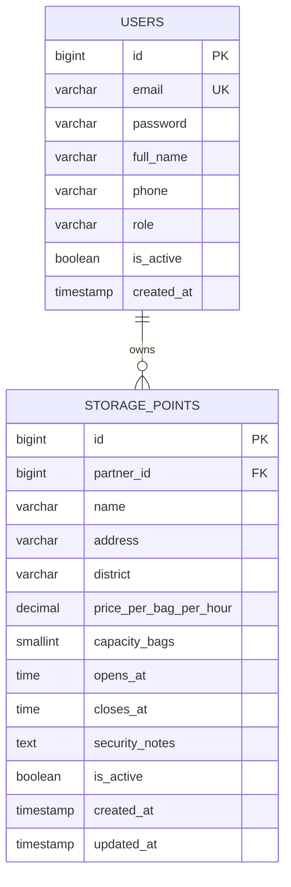

# StorageShare — актуальная схема Sprint 1

Источник истины: `backend/accounts/models.py`, `backend/storage/models.py` и миграции.
Старый план: `db-schema-original.md` / `db-schema-original.png`. Он описывает будущие
бронирования и старую дневную цену; его нельзя считать текущей реализацией.

`users.password` содержит Django hash (не открытый пароль). Есть также стандартные
поля Django AbstractUser: is_staff, is_superuser, last_login, date_joined,
группы и права. JWT blacklist имеет вспомогательные таблицы SimpleJWT.

Регистрация требует full_name и role; role хранится как traveler / partner.
Email уникален; API приводит адрес к нижнему регистру и проверяет повтор без учёта
регистра. phone необязателен. Пароль минимум 8 символов плюс валидаторы Django.

Точки: цена в KZT за сумку в час, неотрицательная; вместимость строго положительна.
Район — один из alatau, almaly, auezov, bostandyk, medeu, nauryzbai, turksib, zhetysu.
Есть индексы по district и (district, is_active), ограничения допустимых районов.
FK partner защищён от удаления через Django PROTECT. Выбор партнёра в admin ограничен
role=partner; это ограничение выбора формы, а не отдельный CHECK на роль FK в БД.
Неактивные точки не выдаются; запрос их деталей возвращает 404.

## Следующий этап (не реализован)

Таблица bookings, API бронирования, подсчёт доступной вместимости, QR и переходы
статусов будут добавлены отдельными миграциями. Для ночных бронирований предусмотрите
два timestamp drop_off_at / pick_up_at вместо date + двух time. Политику округления
неполного часа, часовых поясов и расписаний следует согласовать при реализации US-04.
